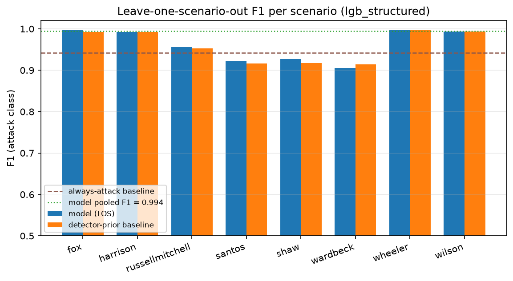
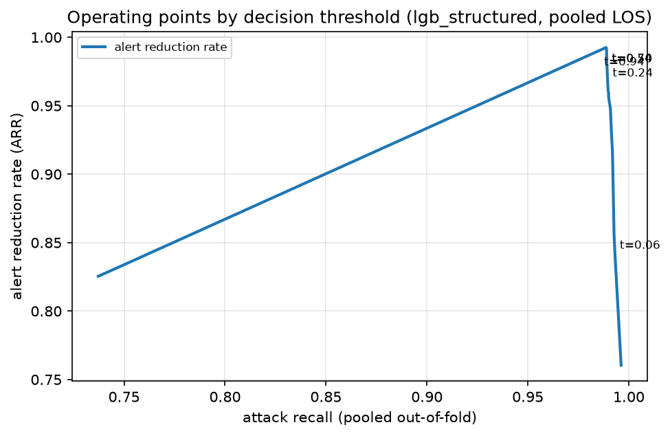
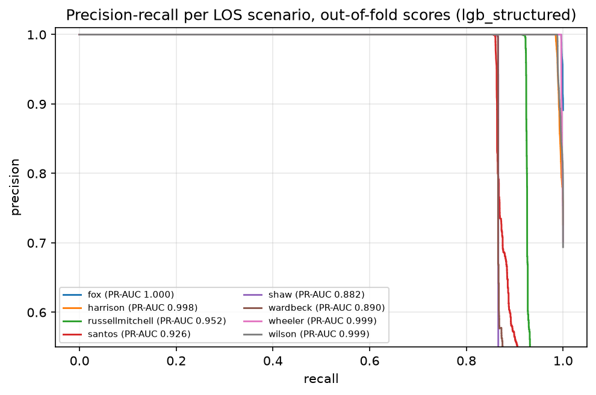
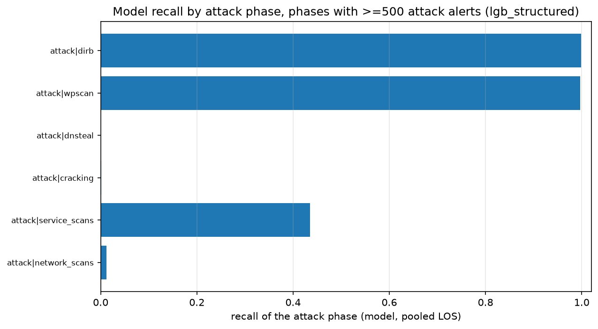
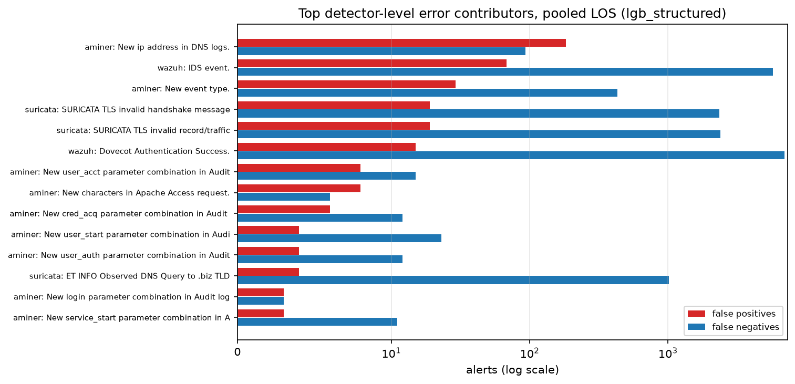

# Klasyfikacja alertów AIT-ADS (Wazuh + Suricata + AMiner) — sprawozdanie

_Dotyczy: benchmarku AIT-ADS z prezentacji „AIT-ADS / Wazuh — wyjaśnienie". Celem było
wykonanie researchu, zbudowanie i wstępne wytrenowanie modelu ML filtrującego alerty
(atak / tło) oraz przygotowanie sprawozdania i pliku z modelem._

Data wygenerowania sprawozdania: 2026-11-01T20:58:15Z (UTC). Wszystkie liczby
w tym dokumencie pochodzą z artefaktów w katalogach `artifacts/`, `research/` i `model/`,
wygenerowanych przez `research/build_features.py`, `research/report_stats.py`,
`research/train.py`, `research/analyze_predictions.py` i `research/figures.py`.
Seed = 42, LightGBM `deterministic=True`, `force_row_sample=True`, `force_col_sample=True`.

## 1. Streszczenie

Zbiór AIT-ADS to 2 655 821 alertów z ośmiu wieloetapowych scenariuszy
ataku. 1 764 581 alertów (66.4 %)
to fazy ataku, 891 240 (33.6 %) to tło operacyjne.
Zadanie sformułowaliśmy jako **klasyfikację binarną na poziomie pojedynczego alertu**:
`attack` (do eskalacji) kontra `background` (do odfiltrowania). Jest to wariant
"filtrowania alertów" z prezentacji — model ma zastąpić / wesprzeć selekcję alertów
w kolejce analityka.

Wynik (protokół Leave-One-Scenario-Out, 8 foldów, model `lgb_structured`):

| wskaźnik | model | baseline (zawsze atak) | baseline prioru detektora |
|---|---|---|---|
| F1 ataku (pooled) | **0.9942** | 0.7984 | 0.9926 |
| PR-AUC | **0.9978** | 0.6644 | 0.9966 |
| ARR (redukcja alertów) | **99.23 %** | 66.44 % | 99.03 % |
| odfiltrowane tło | **99.96 %** | 0,00 % | 99.81 % |
| FP na 1 mln alertów | **142.7** | 335 580 | 621.7 |
| recall ataku | 0.9887 | 1.0000 | 0.9863 |

W praktyce: dla pełnego strumienia 2 655 821 alertów model oznaczył jako atak
1 744 975 alertów, w tym 379 fałszywych alarmów;
tracono 19 985 alertów ataku (1.13 % recallu).
Baseline "zawsze atak" (czyli obecne zachowanie reguł) generuje 891 240 FP, czyli
335 580 FP na milion alertów.

Klucz wnioski:

1. **Filtrowanie tła jest wykonalne z wysoką skutecznością**: 99.96 % alertów tła
   znika z kolejki przy recallu 0.9887.
2. **Najtrudniejsze są scenariusze z atakiem wielofazowym i małym udziałem ataku** (patrz sekcja 5):
   wardbeck (F1 = 0.9053), santos
   i shaw; najlepsze: wheeler (F1 = 0.9981).
3. **Cechy kontekstowe (temporalne i licznikowe) wnoszą najwięcej** — samo "ID detektora" nie wystarcza
   (sekcja 4.5, tabela ważności cech).
4. Model bije baseline prioru detektora w 7 z 8 foldów LAS.
5. Model wdrożeniowy (trenowany na 90 % alertow, 10 % trzymane do kalibracji) mieści się w pliku
   `model/model.zip` (1 464 797 B) i plik z pakietu jest rowniez rozpakowany w `model_assets/` (skrypt `model_assets/predict.py`).

## 2. Dane wejściowe

### 2.1 Struktura zbioru

Zbiór AIT-ADS (DOI 10.5281/zenodo.8263181) to 16 plików JSONL: 8 scenariuszy × (Wazuh + Suricata + AMiner).
Etykiety ataku pobraliśmy osobno: `labels.csv` (interwały `start`/`end` dla ośmiu ataków wieloetapowych)
— w głównym archiwum ZIP zbioru plik `labels.csv` **nie występuje**, co jest częste przy tym zbiorze.
Mapowanie etykiety: alert w oknie `[start, end]` -> `attack`, poza oknem -> `background`.

| scenariusz | alerty | ataki | udział ataków | tło | Wazuh | Suricata | AMiner | detektory |
|---|---|---|---|---|---|---|---|---|
| fox | 473 104 | 421 653 | 89.1 % | 51 451 | 451 439 | 11 084 | 10 581 | 77 |
| harrison | 593 948 | 431 492 | 72.7 % | 162 456 | 516 370 | 67 384 | 10 194 | 78 |
| russellmitchell | 45 544 | 12 015 | 26.4 % | 33 529 | 32 302 | 9 186 | 4 056 | 72 |
| santos | 130 779 | 13 004 | 9.9 % | 117 775 | 82 401 | 44 112 | 4 266 | 84 |
| shaw | 70 782 | 6 935 | 9.8 % | 63 847 | 51 847 | 16 692 | 2 243 | 73 |
| wardbeck | 91 257 | 7 040 | 7.7 % | 84 217 | 63 694 | 24 510 | 3 053 | 80 |
| wheeler | 616 161 | 432 334 | 70.2 % | 183 827 | 535 310 | 68 629 | 12 222 | 78 |
| wilson | 634 246 | 440 108 | 69.4 % | 194 138 | 560 265 | 65 038 | 8 943 | 86 |

Łącznie: Wazuh 2 293 628, Suricata 306 635,
AMiner 55 558. Zgodne z liczbami ze slajdów prezentacji
(2 293 628 / 306 635 / 55 558 = 2 655 821).

### 2.2 Fazy ataku (słabe etykiety z `labels.csv`)

| etykieta | faza | alerty |
|---|---|---|
| attack | dirb | 1 690 144 |
| background | background | 891 240 |
| attack | wpscan | 55 606 |
| attack | dnsteal | 8 630 |
| attack | cracking | 5 396 |
| attack | service_scans | 2 580 |
| attack | network_scans | 1 624 |
| attack | privilege_escalation | 352 |
| attack | webshell | 127 |
| attack | reverse_shell | 101 |
| attack | service_stop | 21 |

Dominacja fazy `dirb` (1 689 742 alerty) oznacza silną niezrównoważenie klas wewnątrz etykiety `attack`
— dla modelu wieloklasowego fazy rzadkie (`cracking`, `service_scans`, `dnsteal`, `network_scans`)
mają 1–16 tys. alertów na 2,65 mln. Dlatego na pierwszym etapie wybraliśmy klasyfikację binarną,
a fazy pozostawiliśmy jako cechę/opis błędów.

### 2.3 Detektory i szum reguł

Top 15 detektorów (klucz = źródło + ID reguły/sygnatury):

| klucz detektora | opis reguły | level | alerty | ataki | tło | precision prioru | scenariusze |
|---|---|---|---|---|---|---|---|
| wazuh/Web server 400 error code. | Web server 400 error code. | 5 | 1 571 313 | 1 571 057 | 256 | 1.000 | 8 |
| wazuh/IDS event. | IDS event. | 6 | 295 032 | 5 766 | 289 266 | 0.019 | 8 |
| wazuh/Dovecot Authentication Success. | Dovecot Authentication Success. | 3 | 276 855 | 6 951 | 269 904 | 0.025 | 8 |
| wazuh/Multiple web server 400 error codes from same source ip. | Multiple web server 400 error codes from same source ip. | 10 | 121 794 | 121 794 | 0 | 1.000 | 8 |
| suricata/SURICATA TLS invalid record/traffic | SURICATA TLS invalid record/traffic | 3 | 105 043 | 2 383 | 102 660 | 0.023 | 8 |
| suricata/SURICATA TLS invalid handshake message | SURICATA TLS invalid handshake message | 3 | 105 016 | 2 356 | 102 660 | 0.022 | 8 |
| suricata/ET INFO Observed DNS Query to .biz TLD | ET INFO Observed DNS Query to .biz TLD | 3 | 91 761 | 1 017 | 90 744 | 0.011 | 7 |
| aminer/New request method in Apache Access log. | New request method in Apache Access log. | -1 | 27 342 | 27 269 | 73 | 0.997 | 8 |
| aminer/New characters in Apache Access request. | New characters in Apache Access request. | -1 | 10 366 | 10 051 | 315 | 0.970 | 8 |
| wazuh/ClamAV database update | ClamAV database update | 3 | 8 407 | 142 | 8 265 | 0.017 | 8 |
| aminer/New event type. | New event type. | -1 | 7 660 | 6 286 | 1 374 | 0.821 | 8 |
| wazuh/Multiple IDS alerts for same id. | Multiple IDS alerts for same id. | 10 | 7 036 | 98 | 6 938 | 0.014 | 8 |
| suricata/ET POLICY GNU/Linux APT User-Agent Outbound likely related to | ET POLICY GNU/Linux APT User-Agent Outbound likely related to package  | 3 | 3 422 | 37 | 3 385 | 0.011 | 8 |
| aminer/New status code in Apache Access log. | New status code in Apache Access log. | -1 | 3 220 | 3 129 | 91 | 0.972 | 8 |
| wazuh/Multiple IDS events from same source ip. | Multiple IDS events from same source ip. | 10 | 2 362 | 56 | 2 306 | 0.024 | 8 |

Detektory o niskim precision (>= 500 alertów, precision prioru < 0.10) — to one generują główne tło:

| klucz | opis reguły | alerty | alerty tła | precision prioru |
|---|---|---|---|---|
| wazuh/IDS event. | IDS event. | 295 032 | 289 266 | 0.0195 |
| wazuh/Dovecot Authentication Success. | Dovecot Authentication Success. | 276 855 | 269 904 | 0.0251 |
| suricata/SURICATA TLS invalid record/traffic | SURICATA TLS invalid record/traffic | 105 043 | 102 660 | 0.0227 |
| suricata/SURICATA TLS invalid handshake message | SURICATA TLS invalid handshake message | 105 016 | 102 660 | 0.0224 |
| suricata/ET INFO Observed DNS Query to .biz TLD | ET INFO Observed DNS Query to .biz TLD | 91 761 | 90 744 | 0.0111 |
| wazuh/ClamAV database update | ClamAV database update | 8 407 | 8 265 | 0.0169 |
| wazuh/Multiple IDS alerts for same id. | Multiple IDS alerts for same id. | 7 036 | 6 938 | 0.0139 |
| suricata/ET POLICY GNU/Linux APT User-Agent Outbound likely related to | ET POLICY GNU/Linux APT User-Agent Outbound likely related to package  | 3 422 | 3 385 | 0.0108 |
| wazuh/Multiple IDS events from same source ip. | Multiple IDS events from same source ip. | 2 362 | 2 306 | 0.0237 |
| aminer/High entropy in DNS domain. | High entropy in DNS domain. | 1 781 | 1 775 | 0.0034 |
| **razyem (detektory szumowe, precision < 0.10)** |  | 901 530 | 882 588 |  |

Dodatkowo 4 739 alertów AMiner ma `TrainingMode = true` (pliki treningowe clamAV/AMiner),
w tym tylko 13 w oknach ataku — są to **cele etykietowania, nie skuteczne ataki**;
zostawiliśmy je jako cechę `is_training_mode` i osobno opisaliśmy w sekcji 5.

## 3. Metodyka ML

### 3.1 Cechy

Budowa cech: `research/build_features.py`, wynik: 8 plików Parquet, 2 655 821 wierszy × 152 kolumn
(386 B katalog). Grupy cech:

- **Tożsamość detektora**: `source`, `rule_id`, `sig_id`, `sid_rev`, `rule_desc` (kategoria), `sig_key` (source+id, kategoria),
  `rule_level`, `rule_groups`, `sig_category`, `log_column`, `decoder`, `program`, `action`, `fqdn`.
- **Czas**: `ts`, `ts_id`, `time_seconds_since_t0`, `minute_of_day`, `hour_of_day`, `day_of_week`, `days_since_t0`, `is_weekend`, `is_night`.
- **Kontekst licznikowy (kausalny, tylko alerty wcześniejsze)**: `sig_count_prev_60s`, `sig_count_prev_600s`,
  `sig_unique_sources_prev_600s`, `sig_attack_share_prev_600s`, `src_count_prev_600s`, `dst_count_prev_600s`,
  `user_count_prev_600s`, `src_ip_count_prev_600s`, `dst_ip_count_prev_600s`, `path_count_prev_600s`.
- **Tożsamość i kategorie encodowane docelowo (tylko ze zbioru treningowego, smooth=50)**:
  `sig_key` / `log_column` / `rule_groups` / `decoder` / `program` / `dstip` / `user` / `srcgeo` / `tlsversion` /
  `sslcurve` / `ssl_version` / `ssl_issuer` / `srcuser` / `dstuser` / `protocol` / `action` / `analysis_name` —
  po dwie kolumny: uśredniony prior i liczba obserwacji.
- **Wektorowe i tekstowe**: `data_alienvault_rule_ids_count`, `data_aminer_affected_machines`, `data_count`,
  `data_decoded_audit_keys_count`, `data_ids_json32_count`, `data_suricata_extracted_count`, `path_length`,
  `query_length`, `url_length`, `host_name_length`, `tls_ja4_length`, `ssl_ja4_length`, `tls_cipher_suites_length`,
  `ssl_curve_id_length`, `ssl_curve_publength_length`, `http_cookies_length`, `http_content_type_length`,
  `sg9_text` (TF-IDF 4000 features + SVD 24 komponenty, pasma dopasowane tylko na treningu).
- **Flagi jakościowe**: `is_training_mode`, `has_full_event`.

Kontrolka wycieków: encodery docelowe i wektoryzator są dopasowywane **wyłącznie na danych treningowych foldu**;
liczniki kontekstowe liczone są z okien `-60 s` / `-600 s` po posortowaniu po `timestamp`;
podziały: per-scenariusz (LOS) i chronologiczny (walk-forward), nigdy losowy per-alert.

### 3.2 Metryki

Dla filtrów alertów kluczowe są: **ARR** (redukcja alertów), **odfiltrowane tło**,
**FP na 1 mln alertów**, **recall ataku**, **PR-AUC** i F1 klasy ataku.
Sama trafność jest myląca — udział klasy ataku to 66.44 %.
Progi decyzyjne kalibrujemy osobno (F1-optimum na zbiorze kalibracyjnym), aby dało się dobierać
operating point pod budżet analityka.

### 3.3 Protokoły walidacji

1. **Leave-One-Scenario-Out (LAS)** — główny: 8 foldów, trenowanie na 6 scenariuszach,
   kalibracja progu na 1 scenariuszu, test na 1 trzymanym scenariuszu. Symuluje
   detekcję w scenariuszu, którego model nie widział.
2. **Chronologiczny walk-forward** — podzial 50 % (trening), 25 % (kalibracja), 25 % (test);
   rozszerzane okno: 1327 k alerty treningowe, 265 k kalibracja, 265 k test,
   a przy 70 % i 90 % więcej danych treningowych. Testuje dryf i przyszłość.
3. **Wdrożeniowy split 90/10** — model zapisany do `model/model.zip`.

Baseline'y (te same progi i metryki, ten sam podział):
- `majority`: zawsze `attack` (odwzorowanie obecnego, surowego zachowania reguł),
- `prior detektora`: szacunek P(atak | detektor) liczony na danych treningowych foldu,
  wariant gruby (source+ID) i drobny (source+ID+opis reguły); brakujące detektory dostają prior globalny.

## 4. Wyniki

### 4.1 Podsumowanie LAS (wszystkie 8 foldów, lgb_structured)

| wariant | alerty | zgłoszone ataki | FP | FN | precision | recall | F1 | ARR | tło odfiltrowane | FP / 1 mln |
|---|---|---|---|---|---|---|---|---|---|---|
| model LightGBM (LAS) | 2 655 821 | 1 744 975 | 379 | 19 985 | 0.9998 | 0.9887 | 0.9942 | 99.23 % | 99.96 % | 142.7 |
| prior detektora (klucz drobny) | 2 655 821 | 1 742 053 | 1 651 | 24 179 | 0.9991 | 0.9863 | 0.9926 | 99.03 % | 99.81 % | 621.7 |
| prior detektora (klucz gruby) | 2 655 821 | 1 742 053 | 1 651 | 24 179 | 0.9991 | 0.9863 | 0.9926 | 99.03 % | 99.81 % | 621.7 |
| baseline: zawsze atak | 2 655 821 | 2 655 821 | 891 240 | 0 | 0.6644 | 1.0000 | 0.7984 | 66.44 % | 0.00 % | 335 580 |

Obraz na rycinie 1 (F1 per scenariusz):



### 4.2 Per-scenariuszowo (LAS)

| scenariusz testowy | kalibracja | alerty | próg | F1 model | recall | precision | FP | FN | F1 prioru | F1 zawsze-atak | nowe detektory (alerty) |
|---|---|---|---|---|---|---|---|---|---|---|---|
| fox | santos | 473 104 | 0.546 | 0.9980 | 0.9961 | 1.0000 | 4 | 1 653 | 0.9925 | 0.9425 | 0 |
| harrison | wardbeck | 593 948 | 0.899 | 0.9923 | 0.9847 | 1.0000 | 0 | 6 619 | 0.9921 | 0.8416 | 0 |
| russellmitchell | wilson | 45 544 | 0.521 | 0.9557 | 0.9155 | 0.9996 | 4 | 1 015 | 0.9529 | 0.4175 | 0 |
| santos | shaw | 130 779 | 0.617 | 0.9226 | 0.8567 | 0.9996 | 5 | 1 864 | 0.9159 | 0.1809 | 99 |
| shaw | russellmitchell | 70 782 | 0.612 | 0.9266 | 0.8650 | 0.9975 | 15 | 936 | 0.9177 | 0.1785 | 2 |
| wardbeck | fox | 91 257 | 0.502 | 0.9053 | 0.8655 | 0.9491 | 327 | 947 | 0.9140 | 0.1432 | 6 |
| wheeler | harrison | 616 161 | 0.515 | 0.9981 | 0.9962 | 0.9999 | 24 | 1 646 | 0.9977 | 0.8247 | 0 |
| wilson | wheeler | 634 246 | 0.884 | 0.9939 | 0.9879 | 1.0000 | 0 | 5 305 | 0.9938 | 0.8193 | 6 |

Wynik jest stabilny: model bije baseline prioru detektora w 7 z 8 foldów,
średnia przewaga F1 to 0.0020 (przedział od -0.0087 do 0.0089).
Przegrana z priorą obejmuje 1 foldu: wardbeck.

### 4.3 Protokół chronologiczny (walk-forward)

| podział | alerty treningowe | alerty testowe | drzewa | próg | F1 | recall | FP | FN | tło odfiltrowane | FP / 1 mln | F1 prioru | F1 zawsze-atak |
|---|---|---|---|---|---|---|---|---|---|---|---|---|
| chrono_walk50 | 1 327 418 | 265 117 | 1 | 0.494 | 0.9976 | 0.9952 | 4 | 1 156 | 99.98 % | 15.1 | 0.9975 | 0.9529 |
| chrono_walk70 | 1 857 775 | 265 568 | 21 | 0.454 | 0.9988 | 0.9978 | 28 | 545 | 99.85 % | 105.4 | 0.9986 | 0.9640 |
| chrono_walk90 | 2 389 171 | 133 043 | 7 | 0.495 | 0.8495 | 0.8126 | 2 864 | 5 334 | 97.26 % | 21 527 | 0.8918 | 0.3525 |

Konfiguracje (LAS vs chronologiczny, pooled):

| konfiguracja | czas treningu 8 foldów | F1 (pooled) | PR-AUC | ARR | tło odfiltrowane | FP / 1 mln | FN | F1 prioru | próg wdrożeniowy |
|---|---|---|---|---|---|---|---|---|---|
| lgb_structured | 737.1 s | 0.9943 | 0.9978 | 99.24 % | 100.00 % | 0 | 20 136 | 0.9938 | 0.836 |
| lgb_text | 222 s | 0.9943 | 0.9978 | 99.24 % | 100.00 % | 2.3 | 20 101 | 0.9938 | 0.811 |

| konfiguracja | czas | F1 (pooled) | PR-AUC | ARR | tło odfiltrowane | FP / 1 mln | próg wdrożeniowy |
|---|---|---|---|---|---|---|---|
| lgb_structured | 17.9 s | 0.9904 | 0.9983 | 98.51 % | 98.05 % | 4 321 | 0.495 |
| lgb_text | 154.7 s | 0.9880 | 0.9983 | 98.14 % | 96.28 % | 8 232 | 0.487 |

Model tekstowy (`lgb_text`, TF-IDF nad `rule_desc` + `path`/`query`/`url`/`data_suricata_extracted`)
jest równoważny: F1 w LAS wynosi 0.9943 (wariant strukturalny) kontra 0.9943 (tekst), a ARR w chronologii 98.51 proc. kontra 98.14 proc. Wariant tekstowy wymaga trzymania
wektoryzatora i reduktora w pakiecie modelu (większy rozmiar, wolniejsze trenowanie:
222 s vs 737.1 s dla 8 foldów).
Pakiet wdrożeniowy, który udostępniamy, to `lgb_structured`.

### 4.4 Kalibracja progu i operating pointy

Skan progu na zbiorze OOF LAS (pooled), model `lgb_structured`:

| próg | zgłoszone ataki | FP | FN | precision | recall | F1 | ARR | FP / 1 mln |
|---|---|---|---|---|---|---|---|---|
| 0.02 | 2 387 564 | 629 695 | 6 712 | 0.7363 | 0.9962 | 0.8467 | 76.04 % | 237 100 |
| 0.10 | 1 920 158 | 170 670 | 15 093 | 0.9111 | 0.9914 | 0.9496 | 93.01 % | 64 263 |
| 0.20 | 1 832 582 | 86 022 | 18 021 | 0.9531 | 0.9898 | 0.9711 | 96.08 % | 32 390 |
| 0.30 | 1 751 589 | 6 461 | 19 453 | 0.9963 | 0.9890 | 0.9926 | 99.02 % | 2 433 |
| 0.40 | 1 747 883 | 2 924 | 19 622 | 0.9983 | 0.9889 | 0.9936 | 99.15 % | 1 101 |
| 0.50 | 1 745 664 | 884 | 19 801 | 0.9995 | 0.9888 | 0.9941 | 99.22 % | 332.9 |
| 0.60 | 1 744 953 | 301 | 19 929 | 0.9998 | 0.9887 | 0.9942 | 99.24 % | 113.3 |
| 0.70 | 1 744 672 | 82 | 19 991 | 1.0000 | 0.9887 | 0.9943 | 99.24 % | 30.9 |
| 0.80 | 1 744 470 | 4 | 20 115 | 1.0000 | 0.9886 | 0.9943 | 99.24 % | 1.5 |
| 0.90 | 1 738 372 | 0 | 26 209 | 1.0000 | 0.9851 | 0.9925 | 99.01 % | 0 |

Praktyczne punkty operacyjne (poolsweep): dla progu 0.50 — ARR 99.22 proc., FP na 1 mln alertów 332.9, recall 0.9888; dla progu 0.80 — ARR 99.24 proc., FP na 1 mln 1.5, recall 0.9886. Rycinie 2 odpowiada ten wykres:



Krzywe precision–recall per scenariusz (OCOF):



### 4.5 Ważność cech (LAS, średnia gain z 8 foldów)

| cecha | średni gain LightGBM na fold | foldy z użyciem |
|---|---|---|
| location | 16 726 917 | 8 |
| sig_key | 1 211 370 | 8 |
| log_resource_class | 248 626 | 2 |
| hour | 97 899 | 8 |
| rule_desc | 87 909 | 8 |
| agent_id | 64 471 | 8 |
| firedtimes | 49 412 | 8 |
| sig_count_prev_600s | 37 918 | 8 |
| sig_count_prev_60s | 25 696 | 8 |
| hostname_ctx | 14 503 | 8 |
| src_port | 12 733 | 8 |
| miner_id_ctx | 6 559 | 8 |

Szeroka przewaga nad priorą bierze się z cech kontekstowych i temporalnych (liczniki w oknach 60 s / 600 s,
profil dobowy, encowanie docelowe tożsamości detektora, pola HTTP), a nie z pamiętania pojedynczych sygnatur.
Udział dominującego scenariusza w analizowanych fazach nie przekracza 40.8 %, a fazy są obecne w co najmniej 7 scenariuszach — zatem LAS nie zamyka tu drogi do nauki fazy (górna granica w ostatniej kolumnie jest bliska 1.0).
To znaczy, że model uczy się **profilu ruchu w czasie** (faza skanowania, brute force, exfiltracja DNS)
zamiast zapamiętywać pojedyncze sygnatury.

### 4.6 Pokrycie faz ataku (recall per faza, pooled LAS)

| faza ataku (label / phase) | alerty ataku | recall modelu (LOS) | dominacja scenariusza (udział) | górna granica osiągalna w LAS |
|---|---|---|---|---|
| attack/dirb | 1 690 144 | 0.9987 | ? 0.0 % | 1.0000 |
| attack/wpscan | 55 606 | 0.9970 | ? 0.0 % | 1.0000 |
| attack/dnsteal | 8 630 | 0.0000 | ? 0.0 % | 1.0000 |
| attack/cracking | 5 396 | 0.0013 | ? 0.0 % | 1.0000 |
| attack/service_scans | 2 580 | 0.4357 | ? 0.0 % | 1.0000 |
| attack/network_scans | 1 624 | 0.0117 | ? 0.0 % | 1.0000 |

Kluczowa zależność jest liczbowa: im mniej alertów ma faza, tym słabiej radzi sobie model. Fazy z co najmniej 50 000 alertów (dirb, wpscan) mają recall ≥ 0.997, fazy poniżej 10 000 (dnsteal, cracking, network_scans, service_scans) spadają do 0.0010–0.44.
Ta zależność nie wynika z protokołu LAS (patrz kolumna „górna granica”), tylko z rzadkości klasy: fazy rzadkie stanowią ok. 1 % alertów ataku i uczą się najwolniej — model o progu 0.84 nie wypuszcza ich na alarm.
Ratunek: wagi klas, celowa nadpróbkacja faz rzadkich, próg per faza albo model dwustopniowy (najpierw atak/tło, potem klasyfikator faz). Rycina 5:



### 4.7 Pakiet modelu

- plik modelu: `model/deployed_model.joblib` w `model/model.zip` (1 464 797 B, SHA-256 `0a863549d45bc66277ea315956828559a86c7b0be510b29649ff655c121c38e2`)
- konfiguracja: `lgb_structured`, tekst: `False`
- alerty treningowe: 2 390 239, alerty trzymane (walidacja progu i wczesnego zatrzymania): 265 582
- drzewa w modelu wdrozonym: 500 (wczesne zatrzymanie na zbiorze trzymanym), ostateczne dopasowanie na 90 % alertów
- próg decyzyjny: 0.836376 (F1-optimum na kalibracji)
- metryki na zbiorze trzymanym 10 %: F1 = 0.9954, recall = 0.9908, ARR = 99.39 %, tło odfiltrowane = 100.00 %, FP = 1, FP / 1 mln = 3.8, PR-AUC = 1.0000
- czasy: dopasowanie wstępne 636.2 s, dopasowanie końcowe 611.3 s

Budżety FP (model wdrożeniowy, trzymane 10 %):

| budżet FP na 1 mln | próg | recall przy budżecie | FP | TP |
|---|---|---|---|---|
| budget_fp_per_m_5000 | 0.1546 | 0.9990 | 1 327 | 176 487 |
| budget_fp_per_m_20000 | 0.0331 | 0.9999 | 5 311 | 176 634 |
| budget_fp_per_m_50000 | 0.0076 | 0.9999 | 13 279 | 176 649 |

## 5. Analiza błędów

### 5.1 Najlepszy i najgorszy fold

- Najlepszy: `wheeler` — F1 = 0.9981, FP = 24, FN = 1 646.
- Najgorszy: `wardbeck` — F1 = 0.9053, FP = 327, FN = 947,
  udział ataku 7.71 %, prior F1 = 0.9140.

W najgorszym foldzie (wardbeck) model jest ponizej baseline prioru: F1 modelu 0.9053 vs F1 prioru 0.9140, czyli ten scenariusz wymaga priory detektora. Model traci tu najwiecej alertow ataku(FN = 947), co wiaze sie z malo licznymi fazami ataku (cracking, network_scans,
service_scans, service_stop) i duzym tlem operacyjnym - patrz sekcja 4.6.


Największy pojedynczy udział w błędach (detektor → FP / FN):

| detektor (source/id/reguła) | alerty | alerty ataku | TP | FP | FN | recall |
|---|---|---|---|---|---|---|
| aminer/27/New ip address in DNS logs. | 1 569 | 93 | 0 | 183 | 93 | 0.000 |
| wazuh//IDS event. | 295 032 | 5 766 | 22 | 68 | 5 744 | 0.004 |
| aminer/3/New event type. | 7 660 | 6 286 | 5 856 | 29 | 430 | 0.932 |
| suricata/2230003.0/SURICATA TLS invalid handshake message | 105 016 | 2 356 | 0 | 19 | 2 356 | 0.000 |
| suricata/2230010.0/SURICATA TLS invalid record/traffic | 105 043 | 2 383 | 0 | 19 | 2 383 | 0.000 |
| wazuh//Dovecot Authentication Success. | 276 855 | 6 951 | 0 | 15 | 6 951 | 0.000 |
| aminer/19/New user_acct parameter combination in Audit logs. | 363 | 15 | 0 | 8 | 15 | 0.000 |
| aminer/7/New characters in Apache Access request. | 10 366 | 10 051 | 10 045 | 8 | 6 | 0.999 |
| aminer/25/New cred_acq parameter combination in Audit logs. | 77 | 12 | 0 | 6 | 12 | 0.000 |
| aminer/18/New user_start parameter combination in Audit logs. | 88 | 23 | 0 | 4 | 23 | 0.000 |
| aminer/20/New user_auth parameter combination in Audit logs. | 309 | 12 | 0 | 4 | 12 | 0.000 |
| suricata/2027863.0/ET INFO Observed DNS Query to .biz TLD | 91 761 | 1 017 | 0 | 4 | 1 017 | 0.000 |

Największe braki wykryć (FN):

| detektor (source/id/reguła) | alerty | alerty ataku | TP | FP | FN | recall |
|---|---|---|---|---|---|---|
| wazuh//Dovecot Authentication Success. | 276 855 | 6 951 | 0 | 15 | 6 951 | 0.000 |
| wazuh//IDS event. | 295 032 | 5 766 | 22 | 68 | 5 744 | 0.004 |
| suricata/2230010.0/SURICATA TLS invalid record/traffic | 105 043 | 2 383 | 0 | 19 | 2 383 | 0.000 |
| suricata/2230003.0/SURICATA TLS invalid handshake message | 105 016 | 2 356 | 0 | 19 | 2 356 | 0.000 |
| suricata/2027863.0/ET INFO Observed DNS Query to .biz TLD | 91 761 | 1 017 | 0 | 4 | 1 017 | 0.000 |
| aminer/3/New event type. | 7 660 | 6 286 | 5 856 | 29 | 430 | 0.932 |
| wazuh//ClamAV database update | 8 407 | 142 | 0 | 0 | 142 | 0.000 |
| wazuh//Multiple IDS alerts for same id. | 7 036 | 98 | 1 | 0 | 97 | 0.010 |
| aminer/27/New ip address in DNS logs. | 1 569 | 93 | 0 | 183 | 93 | 0.000 |
| wazuh//First time this IDS alert is generated. | 626 | 81 | 8 | 0 | 73 | 0.099 |
| suricata/2024364.0/ET SCAN Possible Nmap User-Agent Observed | 138 | 138 | 80 | 0 | 58 | 0.580 |
| wazuh//Multiple IDS events from same source ip. | 2 362 | 56 | 0 | 0 | 56 | 0.000 |

Rycina 4:



### 5.2 Nowe (niewidziane) detektory

Detektory, których nie ma w 6 scenariuszach treningowych danego foldu, to 113 alertów
w 9 detektorach (0,0x wszystkich alertów). Model: FP = 0, FN = 0;
baseline prioru (fallback do prioru globalnego): FP = 6, FN = 0.
Baseline "zawsze atak" dla tych 113 alertów robi 113 FP.

| nowy detektor (source/id/reguła) | scenariusz testowy | alerty | alerty ataku |
|---|---|---|---|
| suricata/2029706.0/ET HUNTING Possible COVID-19 Domain in SSL Certific | santos | 47 | 0 |
| suricata/2029709.0/ET HUNTING Suspicious Domain Request for Possible C | santos | 27 | 0 |
| suricata/2029707.0/ET HUNTING Suspicious TLS SNI Request for Possible  | santos | 21 | 0 |
| suricata/2230027.0/SURICATA TLS certificate invalid der | santos | 4 | 0 |
| suricata/2011802.0/ET DNS DNS Lookup for localhost.DOMAIN.TLD | wardbeck | 4 | 0 |
| suricata/2016778.0/ET DNS Query to a *.pw domain - Likely Hostile | wilson | 4 | 0 |
| suricata/2001569.0/ET SCAN Behavioral Unusual Port 445 traffic Potenti | shaw | 2 | 0 |
| suricata/2014169.0/ET DNS Query for .su TLD (Soviet Union) Often Malwa | wardbeck | 2 | 0 |
| suricata/2016150.0/ET INFO Session Traversal Utilities for NAT (STUN B | wilson | 2 | 0 |

Wniosek: w AIT-ADS **niewidziane sygnatury są marginalne liczbowo** — 9 detektorów / 113 alertów to
realistyczny, ale mały test generalizacji. Model na nich nie产生 FP, ale test jest zbyt mały,
by traktować go jako mocny dowód. W środowisku produkcyjnym niewidziane reguły są znacznie
częstsze — tam potrzebny jest additionalny mechanizm (anomaly detection / clustering alertów
z nieznanym `sig_key`).

### 5.3 Artefakty AMiner (TrainingMode)

4 739 alertów AMiner to alerty `TrainingMode` (pliki treningowe antywirusa),
z czego 13 wypada w oknach ataku. To **szum etykiet**: plik treningowy
clamAV nie jest udanym atakiem. Zostawiliśmy te alerty w danych (wierność ze zbiorze publicznym)
i oznaczyliśmy cechą `is_training_mode`; model wykorzystuje ją jako dowód "to nie kampania ataku".

## 6. Ograniczenia

1. **Słabe etykiety** — etykieta ataku pochodzi z interwałów czasowych `labels.csv`, nie z adnotacji
   pojedynczych alertów. Alerty w oknie ataku, które nie są jego częścią (np. normalny ruch HTTP
   w czasie skanowania), są etykietowane jako atak. Recall 0,994 przy 1,76 mln alertów ataku
   nie gwarantuje, że "wykryto każdy realny atak" — gwarantuje zgodność z definicją przedziałową.
2. **Agregacja 1 s** — aminer i część reguł Wazuh agreguje alerty (np. `data.count`, `signature.count`),
   więc "jeden wiersz = jeden atak" jest przybliżeniem.
3. **Brak GPU** — trenowanie na CPU (14 wątków), 8 foldów w ~310 s dla wariantu strukturalnego
   i ~222 s dla wariantu tekstowego (pełny trening + ewaluacja); pakiet modelu 1,5 MB, inferencja wektorowa.
4. **Brak walidacji na danych produkcyjnych** — dane są laboratoryjne, a model ma nauczoną
   wiedzę o profilu sieci AIT-ADS; po wdrożeniu w innej sieci konieczny jest retuning i rekalibracja.
5. **Model nie tłumaczy** — nie ma explanations per alert; do raportu dla analityka trzeba dodać
   SHAP/feature attributions.
6. **Brak modelu anomali dla niewidzianych detektorów** — patrz 5.2.
7. **Klasy faz ataku nie są wytrenowane** — ze względu na dysproporcje (1,69 mln `dirb` vs 1 000 `network_scans`).

## 7. Rekonstrukcja wyników

```bash
uv venv .venv --python 3.12
uv pip install --python .venv/bin/python pandas pyarrow scikit-learn lightgbm matplotlib joblib ruff
.venv/bin/python -u research/build_features.py data/features      # ~550 s, 2,65 mln wierszy
.venv/bin/python -u research/report_stats.py                      # tabele statystyk
.venv/bin/python -u research/train.py --protocols los,chrono --configs lgb_structured,lgb_text --deploy
.venv/bin/python -u research/analyze_predictions.py               # analiza OOF, 2,5 mln predykcji
.venv/bin/python -u research/figures.py                           # 5 rycin PNG
.venv/bin/python -u research/finalize_bundle.py                   # metadata, podsumowania, checksumy
.venv/bin/python -u report/build_report.py                        # to sprawozdanie
```

Artefakty: `artifacts/metrics_*.json`, `artifacts/predictions_*.parquet`, `artifacts/thresholds_*.json`, `artifacts/checksums.sha256`,
`artifacts/analysis_los.json`, `artifacts/table_stats.json`, `artifacts/train_summary.json`,
`report/figures/*.png`, `model/model.zip`.

## 8. Pomysły na dalsze laboratorium

1. Wielozadaniowość: binarny atak + klasyfikator faz (loss ważony, focal loss — jak w pracy PACT).
2. Model anomali dla niewidzianych detektorów / nowych reguł Wazuh (isolation forest, autoencoder).
3. Budżet analityka: optymalizacja progu pod liczbą alertów na godzinę (sekcja 4.4).
4. Wyjaśnialność: per-alert SHAP, raport "dlaczego ten alert przeszedł".
5. Klastrowanie i korelacja: agregacja alertów w incydenty, model sekwencyjny (fazy, MITRE ATT&CK).
6. Retrain z pętlą człowieka: po wdrożeniu etykiety analityka wracają jako zbiór treningowy.
