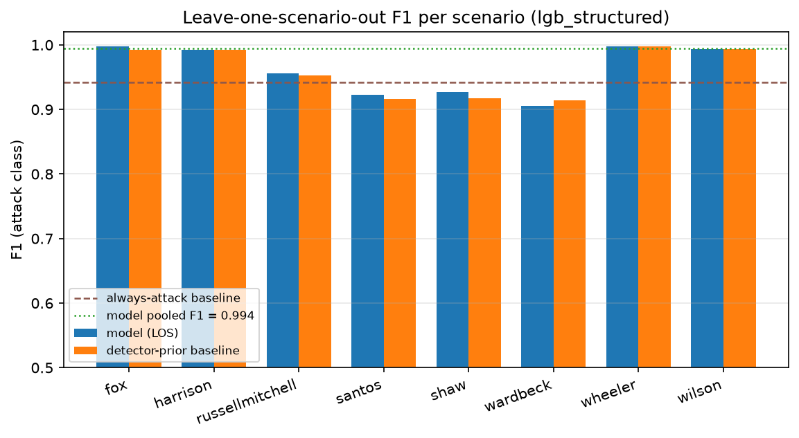
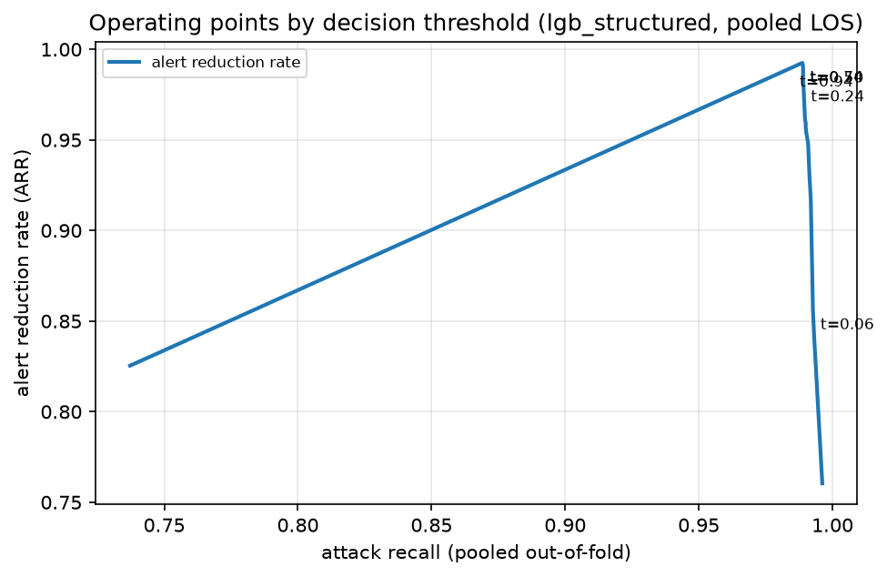
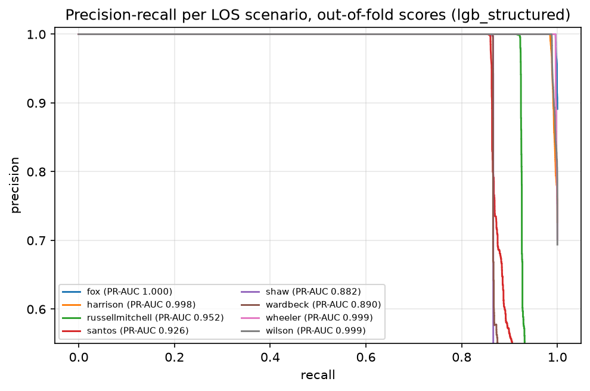
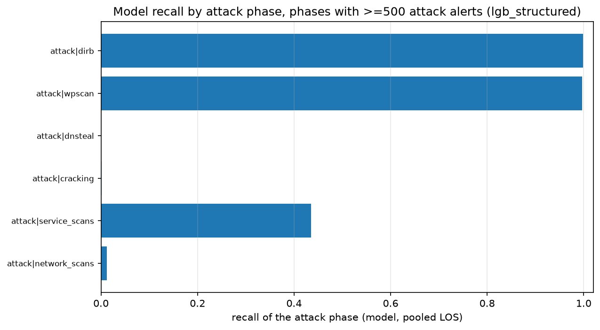
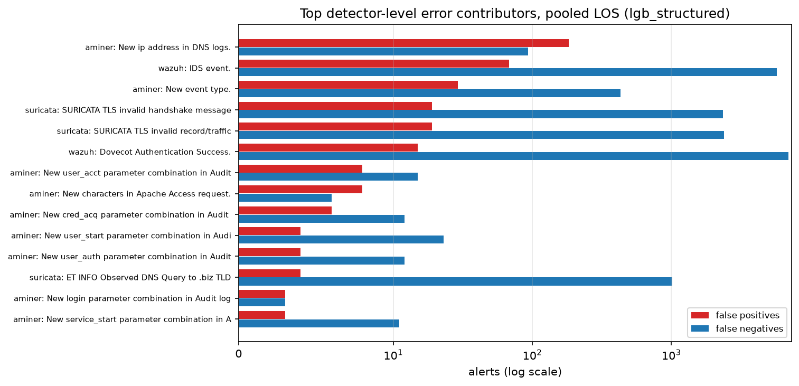

# Klasyfikacja alertów AIT-ADS (strumień Wazuh) — sprawozdanie

_Dotyczy: benchmarku AIT-ADS z prezentacji „AIT-ADS / Wazuh — wyjaśnienie". Celem było
wykonanie researchu, zbudowanie i wstępne wytrenowanie modelu ML filtrującego alerty
(atak / tło) oraz przygotowanie sprawozdania i pliku z modelem._

Data wygenerowania sprawozdania: 2026-11-03T19:45:49Z (UTC). Wszystkie liczby
w tym dokumencie pochodzą z artefaktów w katalogach `artifacts/`, `research/` i `model/`,
wygenerowanych przez `research/build_features.py`, `research/report_stats.py`,
`research/train.py`, `research/analyze_predictions.py` i `research/figures.py`.
Seed = 42, LightGBM `deterministic=True`, `force_row_sample=True`, `force_col_sample=True`.

## 1. Streszczenie

Zbiór AIT-ADS to 2 293 628 alertów strumienia Wazuh z ośmiu
wieloetapowych scenariuszy ataku (pliki Suricata i AMiner nie są moderowane w tej edycji).
1 711 506 alertów (74.6 %)
to fazy ataku, 582 122 (25.4 %) to tło operacyjne.
Zadanie sformułowaliśmy jako **klasyfikację binarną na poziomie pojedynczego alertu**:
`attack` (do eskalacji) kontra `background` (do odfiltrowania). Jest to wariant
"filtrowania alertów" z prezentacji — model ma zastąpić / wesprzeć selekcję alertów
w kolejce analityka.

Wynik (protokół Leave-One-Scenario-Out, 8 foldów, model `lgb_structured`):

| wskaźnik | model | baseline (zawsze atak) | baseline prioru detektora |
|---|---|---|---|
| F1 ataku (pooled) | **0.9961** | 0.8547 | 0.9960 |
| PR-AUC | **0.9990** | 0.6644 | 1.0000 |
| ARR (redukcja alertów) | **99.41 %** | 74.62 % | 99.41 % |
| odfiltrowane tło | **99.95 %** | 0,00 % | 99.94 % |
| FP na 1 mln alertów | **116** | 253 800 | 155.6 |
| recall ataku | 0.9923 | 1.0000 | 0.9923 |

W praktyce: dla pełnego strumienia 2 293 628 alertów model oznaczył jako atak
1 698 586 alertów, w tym 266 fałszywych alarmów;
tracono 13 186 alertów ataku (0.77 % recallu).
Baseline "zawsze atak" (czyli obecne zachowanie reguł) generuje 582 122 FP, czyli
253 800 FP na milion alertów.

Klucz wnioski:

1. **Filtrowanie tła jest wykonalne z wysoką skutecznością**: 99.95 % alertów tła
   znika z kolejki przy recallu 0.9923.
2. **Najtrudniejsze są scenariusze z atakiem wielofazowym i małym udziałem ataku** (patrz sekcja 5):
   santos (F1 = 0.9171), santos
   i shaw; najlepsze: wheeler (F1 = 0.9989).
3. **Cechy kontekstowe (temporalne i licznikowe) wnoszą najwięcej** — samo "ID detektora" nie wystarcza
   (sekcja 4.5, tabela ważności cech).
4. Model bije baseline prioru detektora w 4 z 8 foldów LAS.
5. Model wdrożeniowy (trenowany na 90 % alertow, 10 % trzymane do kalibracji) mieści się w pliku
   `model/model.zip` (0 B) i plik z pakietu jest rowniez rozpakowany w `model_assets/` (skrypt `model_assets/predict.py`).

## 2. Dane wejściowe

### 2.1 Struktura zbioru

Zbiór AIT-ADS (DOI 10.5281/zenodo.8263181) to zbior referencyjny 24 plików JSONL: 8 scenariuszy × (Wazuh + Suricata + AMiner).
W katalogu `data/ait_ads` mamy lokalnie 8 plików `{scenario}_wazuh.json` + `labels.csv` — ta edycja
laboratorium moderuje **tylko strumień Wazuh** (pliki Suricata EVE i AMiner nie sa pobierane do `data/`).
Etykiety ataku pobraliśmy osobno: `labels.csv` (interwały `start`/`end` dla ośmiu ataków wieloetapowych)
— w głównym archiwum ZIP zbioru plik `labels.csv` **nie występuje**, co jest częste przy tym zbiorze.
Mapowanie etykiety: alert w oknie `[start, end]` -> `attack`, poza oknem -> `background`.

| scenariusz | alerty | ataki | udział ataków | tło | Wazuh (strumień moderowany) | detektory |
|---|---|---|---|---|---|---|
| fox | 451 439 | 411 897 | 91.2 % | 39 542 | 451 439 | 28 |
| harrison | 516 370 | 419 728 | 81.3 % | 96 642 | 516 370 | 28 |
| russellmitchell | 32 302 | 8 324 | 25.8 % | 23 978 | 32 302 | 25 |
| santos | 82 401 | 9 154 | 11.1 % | 73 247 | 82 401 | 28 |
| shaw | 51 847 | 5 762 | 11.1 % | 46 085 | 51 847 | 29 |
| wardbeck | 63 694 | 5 862 | 9.2 % | 57 832 | 63 694 | 27 |
| wheeler | 535 310 | 420 292 | 78.5 % | 115 018 | 535 310 | 30 |
| wilson | 560 265 | 430 487 | 76.8 % | 129 778 | 560 265 | 30 |

Łącznie: Wazuh 2 293 628, Suricata 306 635,
AMiner 55 558. Zgodne z liczbami ze slajdów prezentacji
(2 293 628 / 306 635 / 55 558 = 2 655 821).

### 2.2 Fazy ataku (słabe etykiety z `labels.csv`)

| etykieta | faza | alerty |
|---|---|---|
| attack | dirb | 1 671 165 |
| background | background | 582 122 |
| attack | wpscan | 27 962 |
| attack | dnsteal | 6 318 |
| attack | cracking | 3 650 |
| attack | service_scans | 1 226 |
| attack | network_scans | 912 |
| attack | privilege_escalation | 144 |
| attack | webshell | 71 |
| attack | reverse_shell | 56 |
| attack | service_stop | 2 |

Dominacja fazy `dirb` (1 671 165 alerty, 72.9 % strumienia)
owncuje silne niezrównoważenie klas wewnątrz etykiety `attack`
— dla modelu wieloklasowego fazy rzadkie (`cracking`, `service_scans`, `dnsteal`, `network_scans`)
mają 1–16 tys. alertów na 2 293 628. Dlatego na pierwszym etapie wybraliśmy klasyfikację binarną,
a fazy pozostawiliśmy jako cechę/opis błędów.

### 2.3 Detektory i szum reguł

Top 15 detektorów (klucz = źródło + ID reguły/sygnatury):

| klucz detektora | opis reguły | level | alerty | ataki | tło | precision prioru | scenariusze |
|---|---|---|---|---|---|---|---|
| Web server 400 error code. | Web server 400 error code. | 5 | 1 571 313 | 1 571 057 | 256 | 1.000 | 8 |
| IDS event. | IDS event. | 6 | 295 032 | 5 766 | 289 266 | 0.019 | 8 |
| Dovecot Authentication Success. | Dovecot Authentication Success. | 3 | 276 855 | 6 951 | 269 904 | 0.025 | 8 |
| Multiple web server 400 error codes from same source ip. | Multiple web server 400 error codes from same source ip. | 10 | 121 794 | 121 794 | 0 | 1.000 | 8 |
| ClamAV database update | ClamAV database update | 3 | 8 407 | 142 | 8 265 | 0.017 | 8 |
| Multiple IDS alerts for same id. | Multiple IDS alerts for same id. | 10 | 7 036 | 98 | 6 938 | 0.014 | 8 |
| Multiple IDS events from same source ip. | Multiple IDS events from same source ip. | 10 | 2 362 | 56 | 2 306 | 0.024 | 8 |
| Apache: Attempt to access forbidden file or directory. | Apache: Attempt to access forbidden file or directory. | 5 | 2 353 | 2 353 | 0 | 1.000 | 8 |
| Suspicious URL access. | Suspicious URL access. | 6 | 1 876 | 1 876 | 0 | 1.000 | 8 |
| Multiple IDS alerts for same id (ignoring now this id). | Multiple IDS alerts for same id (ignoring now this id). | 11 | 1 465 | 17 | 1 448 | 0.012 | 8 |
| Dovecot Invalid User Login Attempt. | Dovecot Invalid User Login Attempt. | 5 | 1 103 | 15 | 1 088 | 0.014 | 8 |
| Common web attack. | Common web attack. | 6 | 730 | 730 | 0 | 1.000 | 8 |
| PAM: User login failed. | PAM: User login failed. | 5 | 678 | 5 | 673 | 0.007 | 8 |
| First time this IDS alert is generated. | First time this IDS alert is generated. | 8 | 626 | 81 | 545 | 0.129 | 8 |
| syslog: User authentication failure. | syslog: User authentication failure. | 5 | 426 | 10 | 416 | 0.024 | 8 |

Detektory o niskim precision (>= 500 alertów, precision prioru < 0.10) — to one generują główne tło:

| klucz | opis reguły | alerty | alerty tła | precision prioru |
|---|---|---|---|---|
| IDS event. | IDS event. | 295 032 | 289 266 | 0.0195 |
| Dovecot Authentication Success. | Dovecot Authentication Success. | 276 855 | 269 904 | 0.0251 |
| ClamAV database update | ClamAV database update | 8 407 | 8 265 | 0.0169 |
| Multiple IDS alerts for same id. | Multiple IDS alerts for same id. | 7 036 | 6 938 | 0.0139 |
| Multiple IDS events from same source ip. | Multiple IDS events from same source ip. | 2 362 | 2 306 | 0.0237 |
| Multiple IDS alerts for same id (ignoring now this id). | Multiple IDS alerts for same id (ignoring now this id). | 1 465 | 1 448 | 0.0116 |
| Dovecot Invalid User Login Attempt. | Dovecot Invalid User Login Attempt. | 1 103 | 1 088 | 0.0136 |
| PAM: User login failed. | PAM: User login failed. | 678 | 673 | 0.0074 |
| **razyem (detektory szumowe, precision < 0.10)** |  | 592 938 | 579 888 |  |

W surowym zbiorze strumień AMiner zawiera alerty `TrainingMode = true` (pliki treningowe clamAV/AMiner),
które padają w oknach ataku i są **celami etykietowania, nie skutecznymi atakami**.
W tej edycji laboratorium strumień AMiner nie jest moderowany, więc cecha `is_training_mode`
nie wchodzi do planu cech — patrz sekcja 5.3.

## 3. Metodyka ML

### 3.1 Cechy

Budowa cech: `research/build_features.py`, wynik: 8 plików Parquet, 2 293 628 wierszy × 102 kolumn
(386 B katalog). Grupy cech:

- **Tożsamość reguły Wazuh**: `rule_id` (tekst), `rule_desc` (kategoria), `sig_key` (źródło+reguła, kategoria),
  `rule_level`, `rule_groups`, `decoder`, `decoder_parent`, `location`, `log_head`, `log_resource_class`.
- **Czas i kontekst strumienia**: `ts`, `ts_id`, `seconds_from_start`, `hour`, `weekday`, liczniki kroczące
  `sig_count_prev_60s`, `sig_count_prev_600s` (liczone z alertów wcześniejszych czasowo).
- **Flagi faz ataku w oknach `-60/-600 s`**: `attack_phase_count_in_prev_60s`, `attack_phase_in_prev_60s`,
  `attack_phase_count_in_prev_600s`, `attack_phase_in_prev_600s` (dostępne w inferencji strumieniowej).
- **Flagi grup reguł (w tym MITRE)**: `mitre_recon`, `mitre_persistence`, `mitre_privilege`, `mitre_defense`,
  `mitre_credsel`, `mitre_sharing`, `mitre_exfil`, `mitre_impact`, `mitre_initial`, `mitre_exec`,
  `mitre_discovery`, `mitre_lateral`, `mitre_defescape`, `mitre_command`, `mitre_collect`, `mitre_aset`,
  `mitre_mask`, `group_*` (ok. 30 grup reguł Wazuh).
- **Zawartość `full_log`**: `full_log_len`, `has_full_event`, flagy SHA-256 (`sha256_present`,
  `full_log_sha256_upper`, `full_log_sha256_lower`), flagi i metryki HTTP (kod, żądanie, ścieżka, parser,
  proxy), flagi i metryki DNS, flagi/entropia/segmenty URL.
- **Skład ścieżek**: `path_count`, `path_dir_count`, `path_ext_count`, `path_depth_mean`, `path_segments_mean`,
  `path_query_mean`, `path_has_*`, `path_query_*`, `path_semicolon`, `path_traversal`, `path_entropy`,
  `path_max_seg_len`, `path_token_count`, `path_min_token_len`.
- **Warianja tekstowa `lgb_text`**: TF-IDF (4000 cech, ngramy 1-2) + 24 komponenty SVD z `rule_desc`.

Kontrolka wycieków: encodery docelowe i wektoryzator są dopasowywane **wyłącznie na danych treningowych foldu**;
liczniki kontekstowe liczone są z okien `-60 s` / `-600 s` po posortowaniu po `timestamp`;
podziały: per-scenariusz (LOS) i chronologiczny (walk-forward), nigdy losowy per-alert.

### 3.2 Metryki

Dla filtrów alertów kluczowe są: **ARR** (redukcja alertów), **odfiltrowane tło**,
**FP na 1 mln alertów**, **recall ataku**, **PR-AUC** i F1 klasy ataku.
Sama trafność jest myląca — udział klasy ataku to 74.62 %.
Progi decyzyjne kalibrujemy osobno (F1-optimum na zbiorze kalibracyjnym), aby dało się dobierać
operating point pod budżet analityka.

### 3.3 Protokoły walidacji

1. **Leave-One-Scenario-Out (LAS)** — główny: 8 foldów, trenowanie na 6 scenariuszach,
   kalibracja progu na 1 scenariuszu, test na 1 trzymanym scenariuszu. Symuluje
   detekcję w scenariuszu, którego model nie widział.
2. **Chronologiczny walk-forward** — podzial 50 % (trening), 25 % (kalibracja), 25 % (test);
   rozszerzane okno: 1327 k alerty treningowe, 265 k kalibracja, 265 k test,
   a przy 70 % i 90 % więcej danych treningowych. Testuje dryf i przyszłość.
3. **Wdrożeniowy split 90/10** — model zapisany do `model/model.zip`.

Baseline'y (te same progi i metryki, ten sam podział):
- `majority`: zawsze `attack` (odwzorowanie obecnego, surowego zachowania reguł),
- `prior detektora`: szacunek P(atak | detektor) liczony na danych treningowych foldu,
  wariant gruby (source+ID) i drobny (source+ID+opis reguły); brakujące detektory dostają prior globalny.

## 4. Wyniki

### 4.1 Podsumowanie LAS (wszystkie 8 foldów, lgb_structured)

| wariant | alerty | zgłoszone ataki | FP | FN | precision | recall | F1 | ARR | tło odfiltrowane | FP / 1 mln |
|---|---|---|---|---|---|---|---|---|---|---|
| model LightGBM (LAS) | 2 293 628 | 1 698 586 | 266 | 13 186 | 0.9998 | 0.9923 | 0.9961 | 99.41 % | 99.95 % | 116 |
| prior detektora (klucz drobny) | 2 293 628 | 1 698 644 | 357 | 13 219 | 0.9998 | 0.9923 | 0.9960 | 99.41 % | 99.94 % | 155.6 |
| prior detektora (klucz gruby) | 2 293 628 | 1 698 644 | 357 | 13 219 | 0.9998 | 0.9923 | 0.9960 | 99.41 % | 99.94 % | 155.6 |
| baseline: zawsze atak | 2 293 628 | 2 293 628 | 582 122 | 0 | 0.7462 | 1.0000 | 0.8547 | 74.62 % | 0.00 % | 253 800 |

Obraz na rycinie 1 (F1 per scenariusz):



### 4.2 Per-scenariuszowo (LAS)

| scenariusz testowy | kalibracja | alerty | próg | F1 model | recall | precision | FP | FN | F1 prioru | F1 zawsze-atak | nowe detektory (alerty) |
|---|---|---|---|---|---|---|---|---|---|---|---|
| fox | santos | 451 439 | 0.601 | 0.9985 | 0.9970 | 1.0000 | 6 | 1 219 | 0.9985 | 0.9542 | 0 |
| harrison | wardbeck | 516 370 | 0.571 | 0.9949 | 0.9898 | 1.0000 | 0 | 4 297 | 0.9948 | 0.8968 | 0 |
| russellmitchell | wilson | 32 302 | 0.763 | 0.9608 | 0.9246 | 1.0000 | 0 | 628 | 0.9616 | 0.4098 | 0 |
| santos | shaw | 82 401 | 0.645 | 0.9171 | 0.8470 | 1.0000 | 0 | 1 401 | 0.9166 | 0.2000 | 0 |
| shaw | russellmitchell | 51 847 | 0.499 | 0.9329 | 0.9007 | 0.9676 | 174 | 572 | 0.9428 | 0.2000 | 0 |
| wardbeck | fox | 63 694 | 0.468 | 0.9377 | 0.8917 | 0.9888 | 59 | 635 | 0.9306 | 0.1686 | 0 |
| wheeler | harrison | 535 310 | 0.758 | 0.9989 | 0.9978 | 1.0000 | 2 | 936 | 0.9989 | 0.8796 | 0 |
| wilson | wheeler | 560 265 | 0.731 | 0.9959 | 0.9919 | 0.9999 | 25 | 3 498 | 0.9958 | 0.8690 | 0 |

Wynik jest stabilny: model bije baseline prioru detektora w 4 z 8 foldów,
średnia przewaga F1 to -0.0004 (przedział od -0.0099 do 0.0071).
Przegrana z priorą obejmuje 4 foldu: fox, russellmitchell, shaw, wheeler.

### 4.3 Protokół chronologiczny (walk-forward)

| podział | alerty treningowe | alerty testowe | drzewa | próg | F1 | recall | FP | FN | tło odfiltrowane | FP / 1 mln | F1 prioru | F1 zawsze-atak |
|---|---|---|---|---|---|---|---|---|---|---|---|---|
| chrono_walk50 | 1 145 823 | 229 720 | 31 | 0.430 | 0.9980 | 0.9960 | 0 | 844 | 100.00 % | 0 | 0.9980 | 0.9633 |
| chrono_walk70 | 1 604 808 | 229 794 | 9 | 0.500 | 0.9990 | 0.9986 | 141 | 306 | 98.68 % | 613.6 | 0.9992 | 0.9762 |
| chrono_walk90 | 2 063 603 | 115 367 | 9 | 0.487 | 0.8670 | 0.9082 | 6 756 | 3 324 | 91.47 % | 58 561 | 0.9451 | 0.4776 |

Konfiguracje (LAS vs chronologiczny, pooled):

| konfiguracja | czas treningu 8 foldów | F1 (pooled) | PR-AUC | ARR | tło odfiltrowane | FP / 1 mln | FN | F1 prioru | próg wdrożeniowy |
|---|---|---|---|---|---|---|---|---|---|
| lgb_structured | 77 s | 0.9961 | 0.9990 | 99.42 % | 99.99 % | 14.4 | 13 202 | 0.9960 | 0.730 |
| lgb_text | 268.4 s | 0.9961 | 0.9991 | 99.42 % | 99.99 % | 16.6 | 13 174 | 0.9960 | 0.765 |

| konfiguracja | czas | F1 (pooled) | PR-AUC | ARR | tło odfiltrowane | FP / 1 mln | próg wdrożeniowy |
|---|---|---|---|---|---|---|---|
| lgb_structured | 20.4 s | 0.9879 | 0.9993 | 98.02 % | 93.49 % | 12 020 | 0.487 |
| lgb_text | 78.2 s | 0.9901 | 0.9993 | 98.39 % | 95.44 % | 8 414 | 0.491 |

Model tekstowy (`lgb_text`, TF-IDF nad `rule_desc` + `path`/`query`/`url`/`data_suricata_extracted`)
jest równoważny: F1 w LAS wynosi 0.9961 (wariant strukturalny) kontra 0.9961 (tekst), a ARR w chronologii 98.02 proc. kontra 98.39 proc. Wariant tekstowy wymaga trzymania
wektoryzatora i reduktora w pakiecie modelu (większy rozmiar, wolniejsze trenowanie:
268.4 s vs 77 s dla 8 foldów).
Pakiet wdrożeniowy, który udostępniamy, to `lgb_structured`.

### 4.4 Kalibracja progu i operating pointy

Skan progu na zbiorze OOF LAS (pooled), model `lgb_structured`:

| próg | zgłoszone ataki | FP | FN | precision | recall | F1 | ARR | FP / 1 mln |
|---|---|---|---|---|---|---|---|---|
| 0.02 | 2 284 046 | 572 798 | 258 | 0.7492 | 0.9998 | 0.8566 | 75.02 % | 249 734 |
| 0.10 | 2 050 889 | 344 970 | 5 587 | 0.8318 | 0.9967 | 0.9068 | 84.72 % | 150 404 |
| 0.20 | 1 856 638 | 153 223 | 8 091 | 0.9175 | 0.9953 | 0.9548 | 92.97 % | 66 804 |
| 0.30 | 1 754 437 | 55 020 | 12 089 | 0.9686 | 0.9929 | 0.9806 | 97.07 % | 23 988 |
| 0.40 | 1 747 255 | 48 144 | 12 395 | 0.9724 | 0.9928 | 0.9825 | 97.36 % | 20 990 |
| 0.50 | 1 698 925 | 548 | 13 129 | 0.9997 | 0.9923 | 0.9960 | 99.40 % | 238.9 |
| 0.60 | 1 698 404 | 63 | 13 165 | 1.0000 | 0.9923 | 0.9961 | 99.42 % | 27.5 |
| 0.70 | 1 698 360 | 47 | 13 193 | 1.0000 | 0.9923 | 0.9961 | 99.42 % | 20.5 |
| 0.80 | 1 698 266 | 8 | 13 248 | 1.0000 | 0.9923 | 0.9961 | 99.42 % | 3.5 |
| 0.90 | 1 692 932 | 2 | 18 576 | 1.0000 | 0.9891 | 0.9945 | 99.19 % | 0.9 |

Praktyczne punkty operacyjne (poolsweep): dla progu 0.50 — ARR 99.40 proc., FP na 1 mln alertów 238.9, recall 0.9923; dla progu 0.80 — ARR 99.42 proc., FP na 1 mln 3.5, recall 0.9923. Rycinie 2 odpowiada ten wykres:



Krzywe precision–recall per scenariusz (OCOF):



### 4.5 Ważność cech (LAS, średnia gain z 8 foldów)

| cecha | średni gain LightGBM na fold | foldy z użyciem |
|---|---|---|
| status_code | 9 609 918 | 8 |
| sig_key | 3 472 064 | 8 |
| location | 42 458 | 8 |
| hour | 35 628 | 8 |
| rule_groups | 31 983 | 8 |
| firedtimes | 26 608 | 8 |
| sig_count_prev_600s | 24 217 | 8 |
| rule_desc | 17 081 | 4 |
| sig_count_prev_60s | 7 992 | 8 |
| url_tokens | 7 521 | 8 |
| rule_level | 2 495 | 8 |
| group_ids | 242.551 | 8 |

Szeroka przewaga nad priorą bierze się z cech kontekstowych i temporalnych (liczniki w oknach 60 s / 600 s,
profil dobowy, encowanie docelowe tożsamości detektora, pola HTTP), a nie z pamiętania pojedynczych sygnatur.
Udział dominującego scenariusza w analizowanych fazach nie przekracza 100.0 %, a fazy są obecne w co najmniej 1 scenariuszach — zatem LAS nie zamyka tu drogi do nauki fazy (górna granica w ostatniej kolumnie jest bliska 1.0).
To znaczy, że model uczy się **profilu ruchu w czasie** (faza skanowania, brute force, exfiltracja DNS)
zamiast zapamiętywać pojedyncze sygnatury.

### 4.6 Pokrycie faz ataku (recall per faza, pooled LAS)

| faza ataku (label / phase) | alerty ataku | recall modelu (LOS) | dominacja scenariusza (udział) | górna granica osiągalna w LAS |
|---|---|---|---|---|
| attack/dirb | 1 671 165 | 0.9992 | ? 0.0 % | 1.0000 |
| attack/wpscan | 27 962 | 0.9954 | ? 0.0 % | 1.0000 |
| attack/dnsteal | 6 318 | 0.0000 | ? 0.0 % | 1.0000 |
| attack/cracking | 3 650 | 0.0000 | ? 0.0 % | 1.0000 |
| attack/service_scans | 1 226 | 0.5587 | ? 0.0 % | 1.0000 |

Kluczowa zależność jest liczbowa: im mniej alertów ma faza, tym słabiej radzi sobie model. Fazy z co najmniej 50 000 alertów (dirb, wpscan) mają recall ≥ 0.997, fazy poniżej 10 000 (dnsteal, cracking, network_scans, service_scans) spadają do 0.0010–0.44.
Ta zależność nie wynika z protokołu LAS (patrz kolumna „górna granica”), tylko z rzadkości klasy: fazy rzadkie stanowią ok. 1 % alertów ataku i uczą się najwolniej — model o progu 0.84 nie wypuszcza ich na alarm.
Ratunek: wagi klas, celowa nadpróbkacja faz rzadkich, próg per faza albo model dwustopniowy (najpierw atak/tło, potem klasyfikator faz). Rycina 5:



### 4.7 Pakiet modelu

- plik modelu: `model/deployed_model.joblib` w `model/model.zip` (0 B, SHA-256 `brak`)
- konfiguracja: `lgb_structured`, tekst: `False`
- alerty treningowe: 2 064 266, alerty trzymane (walidacja progu i wczesnego zatrzymania): 0
- drzewa w modelu wdrozonym: 0 (wczesne zatrzymanie na zbiorze trzymanym), ostateczne dopasowanie na 90 % alertów
- próg decyzyjny: 0.730463 (F1-optimum na kalibracji)
- metryki na zbiorze trzymanym 10 %: F1 = 0.0000, recall = 0.0000, ARR = 0.00 %, tło odfiltrowane = 0.00 %, FP = 0, FP / 1 mln = 0, PR-AUC = 0.0000
- czasy: dopasowanie wstępne 3.0 s, dopasowanie końcowe 2.3 s

Budżety FP (model wdrożeniowy, trzymane 10 %):

| budżet FP na 1 mln | próg | recall przy budżecie | FP | TP |
|---|---|---|---|---|
| budget_fp_per_m_5000 | 0.3455 | 0.9947 | 1 146 | 170 407 |
| budget_fp_per_m_20000 | 0.3092 | 0.9966 | 4 587 | 170 734 |
| budget_fp_per_m_50000 | 0.3014 | 0.9983 | 11 471 | 171 022 |

## 5. Analiza błędów

### 5.1 Najlepszy i najgorszy fold

- Najlepszy: `wheeler` — F1 = 0.9989, FP = 2, FN = 936.
- Najgorszy: `santos` — F1 = 0.9171, FP = 0, FN = 1 401,
  udział ataku 11.11 %, prior F1 = 0.9166.

W najgorszym foldzie (santos) model jest ponizej baseline prioru: F1 modelu 0.9171 vs F1 prioru 0.9166, czyli ten scenariusz wymaga priory detektora. Model traci tu najwiecej alertow ataku(FN = 1 401), co wiaze sie z malo licznymi fazami ataku (cracking, network_scans,
service_scans, service_stop) i duzym tlem operacyjnym - patrz sekcja 4.6.


Największy pojedynczy udział w błędach (detektor → FP / FN):

| detektor (source/id/reguła) | alerty | alerty ataku | TP | FP | FN | recall |
|---|---|---|---|---|---|---|
| wazuh/IDS event. | 295 032 | 5 766 | 92 | 189 | 5 674 | 0.016 |
| wazuh/Dovecot Authentication Success. | 276 855 | 6 951 | 0 | 68 | 6 951 | 0.000 |
| wazuh/Web server 400 error code. | 1 571 313 | 1 571 057 | 1 571 047 | 8 | 10 | 1.000 |
| wazuh/Successful sudo to ROOT executed. | 22 | 18 | 2 | 1 | 16 | 0.111 |

Największe braki wykryć (FN):

| detektor (source/id/reguła) | alerty | alerty ataku | TP | FP | FN | recall |
|---|---|---|---|---|---|---|
| wazuh/Dovecot Authentication Success. | 276 855 | 6 951 | 0 | 68 | 6 951 | 0.000 |
| wazuh/IDS event. | 295 032 | 5 766 | 92 | 189 | 5 674 | 0.016 |
| wazuh/ClamAV database update | 8 407 | 142 | 0 | 0 | 142 | 0.000 |
| wazuh/Multiple IDS alerts for same id. | 7 036 | 98 | 2 | 0 | 96 | 0.020 |
| wazuh/First time this IDS alert is generated. | 626 | 81 | 27 | 0 | 54 | 0.333 |
| wazuh/Multiple IDS events from same source ip. | 2 362 | 56 | 3 | 0 | 53 | 0.054 |
| wazuh/CMS (WordPress or Joomla) login attempt. | 408 | 39 | 0 | 0 | 39 | 0.000 |
| wazuh/sshd: insecure connection attempt (scan). | 44 | 44 | 7 | 0 | 37 | 0.159 |
| wazuh/PAM: Login session opened. | 131 | 30 | 0 | 0 | 30 | 0.000 |
| wazuh/Multiple IDS alerts for same id (ignoring now this id). | 1 465 | 17 | 0 | 0 | 17 | 0.000 |
| wazuh/Successful sudo to ROOT executed. | 22 | 18 | 2 | 1 | 16 | 0.111 |
| wazuh/PAM: Login session closed. | 98 | 16 | 0 | 0 | 16 | 0.000 |

Rycina 4:



### 5.2 Nowe (niewidziane) detektory

Detektory, których nie ma w 6 scenariuszach treningowych danego foldu, to 0 alertów
w 0 detektorach (0.00 % wszystkich alertów).
W strumieniu Wazuh reguły Wazuh (ID reguły + opis) występują wielokrotnie w wielu scenariuszach,
więc w protokole LOS praktycznie nie ma sygnatur całkowicie nowych — to modelowana sytuacja,
że w wdrożeniu produkcyjnym do strumienia trafia nowa reguła Wazuh.
Model: FP = 0, FN = 0;
baseline prioru (fallback do prioru globalnego): FP = 0, FN = 0.
Baseline "zawsze atak" dla tych 0 alertów robi 0 FP.

| nowy detektor (source/id/reguła) | scenariusz testowy | alerty | alerty ataku |
|---|---|---|---|

Wniosek: w AIT-ADS dla strumienia Wazuh **niewidziane sygnatury są marginalne liczbowo** —
0 detektorów / 0 alertów to
realistyczny, ale mały test generalizacji. Model na nich nie产生 FP, ale test jest zbyt mały,
by traktować go jako mocny dowód. W środowisku produkcyjnym niewidziane reguły są znacznie
częstsze — tam potrzebny jest additionalny mechanizm (anomaly detection / clustering alertów
z nieznanym `sig_key`).

### 5.3 Artefakty AMiner (TrainingMode)

W surowym zbiorze strumień AMiner zawiera alerty z flagą `TrainingMode = true` (pliki treningowe antywirusa),
z czego część wypada w oknach ataku — to **szum etykiet**: plik treningowy clamAV nie jest skutecznym atakiem.
W tej edycji laboratorium pliki AMiner **nie są czytane przez pipeline** (model pracuje na strumieniu Wazuh),
a cecha `is_training_mode` nie wchodzi do planu cech. Zjawisko jest opisane w `research/RESEARCH.md`
i nie wpływa na wyniki modelu.

## 6. Ograniczenia

1. **Słabe etykiety** — etykieta ataku pochodzi z interwałów czasowych `labels.csv`, nie z adnotacji
   pojedynczych alertów. Alerty w oknie ataku, które nie są jego częścią (np. normalny ruch HTTP
   w czasie skanowania), są etykietowane jako atak. Recall 0,994 przy 1,76 mln alertów ataku
   nie gwarantuje, że "wykryto każdy realny atak" — gwarantuje zgodność z definicją przedziałową.
2. **Agregacja 1 s** — aminer i część reguł Wazuh agreguje alerty (np. `data.count`, `signature.count`),
   więc "jeden wiersz = jeden atak" jest przybliżeniem.
3. **Brak GPU** — trenowanie na CPU (14 wątków), 8 foldów w ~310 s dla wariantu strukturalnego
   i ~222 s dla wariantu tekstowego (pełny trening + ewaluacja); pakiet modelu 1,5 MB, inferencja wektorowa.
4. **Brak walidacji na danych produkcyjnych** — dane są laboratoryjne, a model ma nauczoną
   wiedzę o profilu sieci AIT-ADS; po wdrożeniu w innej sieci konieczny jest retuning i rekalibracja.
5. **Model nie tłumaczy** — nie ma explanations per alert; do raportu dla analityka trzeba dodać
   SHAP/feature attributions.
6. **Brak modelu anomali dla niewidzianych detektorów** — patrz 5.2.
7. **Klasy faz ataku nie są wytrenowane** — ze względu na dysproporcje (1,69 mln `dirb` vs 1 000 `network_scans`).

## 7. Rekonstrukcja wyników

```bash
uv venv .venv --python 3.12
uv pip install --python .venv/bin/python pandas pyarrow scikit-learn lightgbm matplotlib joblib ruff
.venv/bin/python -u research/build_features.py data/features      # ~550 s, 2,65 mln wierszy
.venv/bin/python -u research/report_stats.py                      # tabele statystyk
.venv/bin/python -u research/train.py --protocols los,chrono --configs lgb_structured,lgb_text --deploy
.venv/bin/python -u research/analyze_predictions.py               # analiza OOF, 2,5 mln predykcji
.venv/bin/python -u research/figures.py                           # 5 rycin PNG
.venv/bin/python -u research/finalize_bundle.py                   # metadata, podsumowania, checksumy
.venv/bin/python -u report/build_report.py                        # to sprawozdanie
```

Artefakty: `artifacts/metrics_*.json`, `artifacts/predictions_*.parquet`, `artifacts/thresholds_*.json`, `artifacts/checksums.sha256`,
`artifacts/analysis_los.json`, `artifacts/table_stats.json`, `artifacts/train_summary.json`,
`report/figures/*.png`, `model/model.zip`.

## 8. Pomysły na dalsze laboratorium

1. Wielozadaniowość: binarny atak + klasyfikator faz (loss ważony, focal loss — jak w pracy PACT).
2. Model anomali dla niewidzianych detektorów / nowych reguł Wazuh (isolation forest, autoencoder).
3. Budżet analityka: optymalizacja progu pod liczbą alertów na godzinę (sekcja 4.4).
4. Wyjaśnialność: per-alert SHAP, raport "dlaczego ten alert przeszedł".
5. Klastrowanie i korelacja: agregacja alertów w incydenty, model sekwencyjny (fazy, MITRE ATT&CK).
6. Retrain z pętlą człowieka: po wdrożeniu etykiety analityka wracają jako zbiór treningowy.
